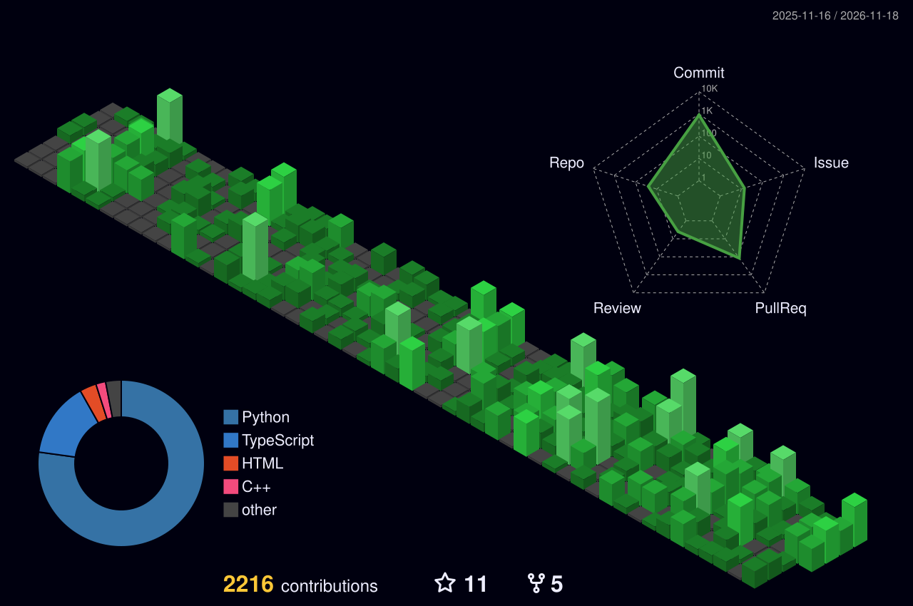

<!--

  <h1>⚠ 施工中 ⚠</h1>

-->

  <h1>Hi there, I'm Vanilla Yukirin 👋</h1>
  
<b>ACMer | MCMer | AFOIer | Data Science & Big Data Technology</b>

  

### 🍓 About Me

- 🌱 **Major**: Data Science and Big Data Technology
- 🎮 **Interests**: Playing GalGames (Visual Novels) and tinkering with interesting things
- 💻 **Goal**: Become an algorithm engineer who solves tough problems with clever code
- ✨ **Vision**: Use code and math to create miracles, making the world just a little more interesting 😊

  

### 🛠️ Tech Stack

  

### 📕 Latest Blog Posts

<!-- BLOG-POST-LIST-CITE:START -->
- [零刻GTi13Ultra进入BIOS切换显卡PCIe通道](https://blog.vanilla-chan.cn/2026/03/06/GTi13Ultra-BIOS-PCIe-Configuration/), `2026-03-05 21:42`
- [Z-Image-Turbo进行LoRA微调流程](https://blog.vanilla-chan.cn/2026/02/14/Z-Image-Turbo-Finetune-LoRA/), `2026-02-14 15:53`
- [解决Windows11端口被随机占用的问题](https://blog.vanilla-chan.cn/2026/02/13/fix-win11-port-occupied/), `2026-02-13 10:49`
- [仅通过一句提示词，就可以让大模型变得更有创造力](https://blog.vanilla-chan.cn/2025/12/17/Verbalized-Sampling/), `2025-12-17 06:14`
- [WSL2如何使用中文字体](https://blog.vanilla-chan.cn/2025/12/16/WSL2-Use-CN-Fonts/), `2025-12-16 08:44`

<!-- BLOG-POST-LIST-CITE:END -->

### 📊 GitHub Stats

<!-- 左 Stats & 右 Languages-->

  
  

<!-- 贪吃蛇 -->

  <picture>
    <source media="(prefers-color-scheme: dark)" srcset="https://raw.githubusercontent.com/Vanilla-Yukirin/Vanilla-Yukirin/snake-output/github-contribution-grid-snake-dark.svg">
    <source media="(prefers-color-scheme: light)" srcset="https://raw.githubusercontent.com/Vanilla-Yukirin/Vanilla-Yukirin/snake-output/github-contribution-grid-snake.svg">
    
  </picture>

### 📈 More Activity

  
<b>✨ Click to expand ✨</b>

   
  

    
      
    
  

### 👀 Visitor Count

  

